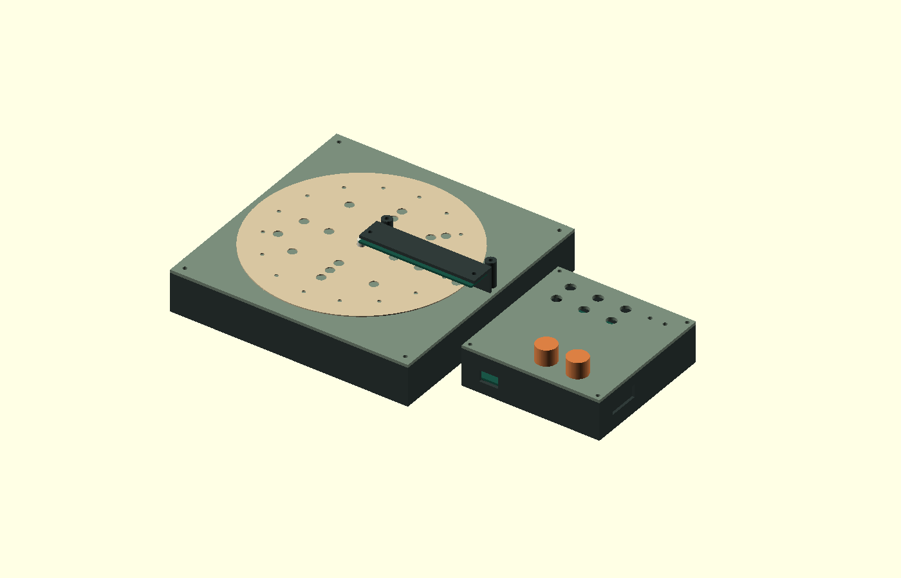
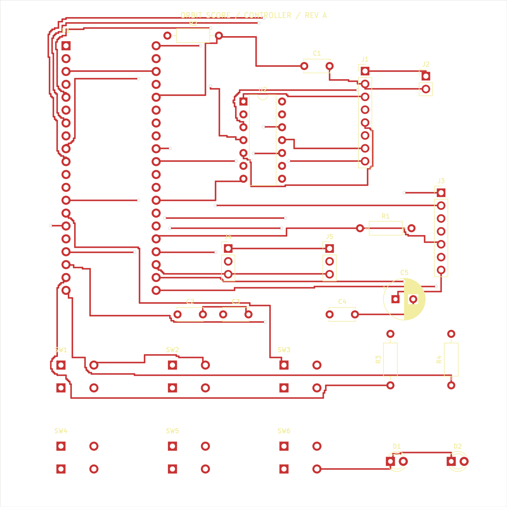

# OrbitScore

A tabletop percussion sequencer that reads interchangeable perforated rhythm discs. One disc stores sixteen steps across four tracks: kick, snare, hi-hat, and tom. Turn the disc by hand to scan the pattern; a Raspberry Pi Pico then loops it at an independent electronic tempo.

## Design

Six optical channels read four data tracks, a clock track, and an index marker. Separate controller, reader, and emitter boards connect the optical scanner to the Pico. A MAX98357A amplifier drives a speaker. Two knobs set tempo and gain; four track mutes control the arrangement.

The 164 mm disc fits a 190 × 190 mm scanner enclosure. The controls occupy a separate 110 × 110 mm pod. The firmware synthesizes the four percussion voices mathematically.

## Files

- `hardware/`: editable KiCad schematics, layouts, local footprints, Gerbers, and drill files for all three boards.
- `mechanical/`: OpenSCAD source, individual printable STL parts, and board STEP references.
- `firmware/`: MicroPython scanner, sequencer, and percussion synthesis.
- `bom.csv`: component list with researched prices and explicitly marked allowances.
- `docs/`: design specifications, assembly wiring, budget, and bring-up procedure.
- `verification/`: firmware and board-check reports.

## Validation and next steps

The supplied reports record nine desktop firmware tests passed, 159 matching schematic/PCB pin assignments, zero unconnected pads, and zero electrical DRC errors. These checks validate files and software logic. The physical assembly, optical sensitivity, ambient-light immunity, Pico audio timing, and printed fit remain untested.

Before fabrication, check purchased component footprints, optical polarity/current, enclosure clearances, and the final vendor carts. The BOM includes procurement allowances and is not a delivered-price quote.

## Opening the project

Open `hardware/controller/controller.kicad_pro` in KiCad 7 or newer. Open `mechanical/orbitscore.scad` in OpenSCAD. See `docs/wiring-and-assembly.txt` and `docs/bring-up.txt` before connecting hardware.
